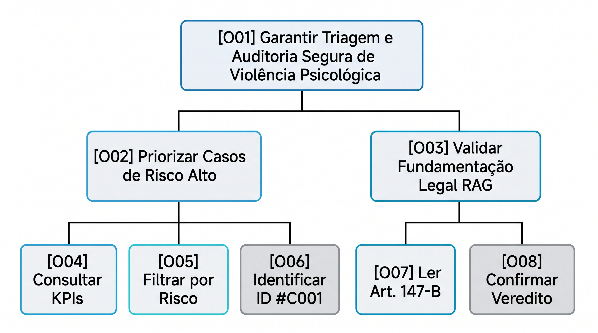

# Entrega 9 — Modelo conceitual e design centrado na comunicação

**Data:** 04/11/2026
**Status:** 🟩 concluída 
**Responsabilidade:** soluções individuais, com consolidação da equipe para mapa de objetivos e esquema de signos.

## Objetivo da atividade

Passar do cenário de problema para uma concepção da interação, explicitando objetivos, tópicos de conversa, falas e signos que a interface deverá comunicar/manipular.

## Transformando resultados técnicos em conceitos compreensíveis

Em TCCs algorítmicos ou orientados a dados, esta entrega deve evitar que a interface exponha apenas estruturas internas do código. Identifique os **conceitos e signos que fazem sentido para o usuário**.

Exemplos:

- `query plan`, custo estimado, recomendação e impacto para um DBA;
- modelo, dataset, versão, execução e métrica para engenheiro de IA;
- período, indicador, grupo, tendência e filtro para gestor/analista;
- alerta, severidade, evidência, responsável e status para analista de segurança.

Se um termo técnico for necessário, modele como será comunicado, explicado e relacionado à tarefa.

Dashboards, relatórios, filtros e CRUDs devem aparecer no modelo conceitual por meio dos **objetivos, signos e conversas** que justificam sua existência.

## 1. Cenários de interação

Para cada cenário de problema, produza uma versão em que a solução já pode ser descrita. **Destaque claramente o texto alterado** em relação ao cenário original.

### CI01 — Triagem e Auditoria de Explicabilidade Jurídica do RAG

**Autor(a):** Laura de Souza Parente — 22.123.033-7 
**Origem:** Cenário Problema C01

{{cenário de interação com alterações marcadas}}

Na segunda-feira pela manhã, a analista Camila abre o Painel Web Administrativo em sua estação de trabalho. Ela visualiza imediatamente nos cartões de KPI no topo da tela que existem 132 casos registrados no total, sendo 28 classificados como Risco Alto. Para priorizar as emergências, Camila clica no botão de filtro rápido ALTO. A tabela é filtrada instantaneamente, apresentando apenas os atendimentos graves. Camila observa a primeira linha da listagem, identificada pelo código anônimo #C001, com data de hoje, categoria principal "Chantagem / Isolamento" e a informação "28/30 mensagens processadas". Sabendo que a quase totalidade da conversa contém indícios de abuso, ela clica no botão AUDITAR. A interface abre a visão detalhada, exibindo no painel esquerdo a transcrição do WhatsApp com as frases abusivas destacadas visualmente. No painel direito, o sistema exibe o card de Explicabilidade RAG apresentando a citação do Art. 147-B do Código Penal, a justificativa da IA e o parecer preliminar. Camila lê a fundamentação legal, confirma que a classificação está correta e clica no botão APROVAR PARECER, registrando a validação humana no sistema.

### Diferenças relevantes

| Alteração | Por que foi necessária | Evidência/artefato que justifica |
|---|---|---|
| Visualização prévia de KPIs e filtragem rápida por risco | Permite à analista identificar o volume de emergências e isolar casos graves em 1 clique sem abrir chamada por chamada. | Walkthrough da Entrega 6 e HTA T01. |
| Exibição da proporção de mensagens processadas (28/30) | Comunica a densidade do comportamento abusivo diretamente na tabela mestre antes de abrir a auditoria detalhada. | Mudança de escopo registrada na Entrega 6 e RASTREABILIDADE.md. |
| Apresentação direta do Card de Explicabilidade RAG (Art. 147-B) | Fundamenta a decisão da IA com embasamento jurídico transparente, garantindo o controle humano (human-in-the-loop). | Hipótese H01 sustentada e Metas de Usabilidade da Entrega 8. |

## 2. Design centrado na comunicação

**Nome do cenário:** {{CI01}}

| Tópico > subtópico | Falas e signos envolvidos | Intenção/efeito esperado |
|---|---|---|
| Triagem Diária de Casos | `D: "Exibindo 132 casos no total, sendo 28 de Risco Alto."` / `U: Seleciona o filtro Risco ALTO.` | Informar o estado global dos atendimentos e permitir o isolamento de casos críticos. |
| > Identificação do Caso Severo | `D: Exibe caso #C001 \| Risco: ALTO \| Proporção: 28/30 mensagens.` / `U: Clica em AUDITAR no caso #C001.` | Comunicar a gravidade do caso sem expor o nome da vítima e encaminhar para a auditoria. |
| Auditoria e Explicabilidade Legal | `D: Exibe transcrição com frases destacadas + Card RAG com Art. 147-B do Código Penal.` / `U: Analisa a fundamentação legal e clica em APROVAR PARECER.` | Explicar o porquê do veredito da IA em termos jurídicos e registrar a confirmação da analista. |

**Convenção:** `U` = usuário; `D` = preposto do designer/sistema, conforme a abordagem de Engenharia Semiótica adotada na disciplina.

## 3. Mapa de objetivos

Cada integrante apresenta seu mapa e a equipe cria um **mapa consolidado**, eliminando duplicidades e resolvendo conflitos de nomenclatura.

### Dicionário de objetivos

| ID | Objetivo | Persona(s) | Cenário(s) | Prioridade |
|---|---|---|---|---|
| O01 | Garantir a triagem eficiente e a auditoria fundamentada de atendimentos | Camila Rocha (P01) | CI01 | Alta |
| O02 | Priorizar atendimentos de Risco Alto na listagem principal | Camila Rocha (P01) | CI01 | Alta |
| O03 | Validar a explicabilidade legal do RAG baseada no Art. 147-B | Camila Rocha (P01) | CI01 | Alta |
| O04 | Consultar métricas estatísticas de resumo nos cartões KPI | Camila Rocha (P01) | CI01 | Média |
| O05 | Filtrar atendimentos por nível de risco (ALTO, MÉDIO, BAIXO) | Camila Rocha (P01) | CI01 | Alta |
| O06 | Identificar o atendimento crítico através do código anônimo `#C001` | Camila Rocha (P01) | CI01 | Alta |
| O07 | Ler o enquadramento do Art. 147-B do Código Penal no painel RAG | Camila Rocha (P01) | CI01 | Alta |
| O08 | Registrar a aprovação ou reclassificação manual do parecer da IA | Camila Rocha (P01) | CI01 | Alta |

## 4. Esquema conceitual de signos

Consolide as informações em **uma tabela única**.

| Grupo | Signo | Origem | Observações/semântica | Tipo de conteúdo | Restrição | Valor padrão | Prevenção | Recuperação |
|---|---|---|---|---|---|---|---|---|
| **Métricas** | `total_casos` | sistema | Total de casos registrados no período | numérico | inteiro ≥ 0 | 0 | leitura apenas | — |
| **Métricas** | `alto_risco_kpi` | sistema | Total de casos classificados com risco alto | numérico | inteiro ≥ 0 | 0 | destaque visual vermelho | — |
| **Filtros** | `filtro_risco` | usuário | Nível de risco selecionado para filtrar a listagem | seleção | ALTO, MÉDIO, BAIXO, TODOS | TODOS | botões com rótulos claros | botão limpar |
| **Filtros** | `campo_busca` | usuário | Busca por código anônimo do caso | texto | alfanumérico | vazio | desativar caracteres especiais | limpar campo |
| **Identificação** | `id_caso` | domínio | Código anônimo mascarado da vítima | texto | formato `#C000` | — | geração automática (LGPD) | — |
| **Classificação** | `nivel_risco` | sistema | Nível de gravidade atribuído pela IA | tag visual | ALTO, MÉDIO, BAIXO | BAIXO | contraste visual por cor | reclassificação manual |
| **Métricas** | `prop_mensagens` | sistema | Razão de mensagens abusivas sobre o total | texto | formato `X/Y` | `0/0` | exibição direta na tabela | — |
| **Explicabilidade** | `artigo_147b` | sistema | Citação do Art. 147-B do Código Penal no RAG | texto | texto legal formatado | — | exibição em caixa destacada | — |
| **Ações** | `btn_auditar` | sistema | Ação para abrir a auditoria do caso | botão | clique simples | habilitado | rótulo claro `AUDITAR` | voltar à tabela |
| **Ações** | `btn_aprovar` | usuário | Confirmação humana da classificação | botão | clique simples | habilitado | mensagem de confirmação | desfazer aprovação |

### Regras para os signos

- Use o vocabulário do domínio do usuário.
- Evite duplicar o mesmo conceito com nomes diferentes.
- Diferencie informação fornecida pelo usuário, produzida pelo sistema e derivada do domínio.
- Registre prevenção e recuperação apenas quando fizer sentido; explique as siglas usadas.

## Síntese

Quais objetivos/tópicos/signos deverão necessariamente aparecer nos diagramas MoLIC?

Os objetivos `O01` a `O08`, os tópicos de conversa da seção 2 e os signos centrais (id_caso, badge_nivel_risco, card_artigo_147b, proporção_mensagens e botão_aprovar) serão diretamente mapeados para os diagramas MoLIC da Entrega 10, garantindo a transição fluida do modelo conceitual para a modelagem de interação.

## Checklist

- [X] Cenários de interação mostram alterações em relação aos cenários de problema.
- [X] Cada solução individual identifica autor e cenário de origem.
- [X] Tópicos/falas/signos são coerentes com objetivos do usuário.
- [X] Mapas individuais foram consolidados.
- [X] O esquema de signos está em uma tabela única e sem duplicações conceituais.
- [X] Nomes de objetivos/signos serão reutilizados na Entrega 10.
- [X] Em TCC técnico, signos representam conceitos do domínio compreensíveis ao usuário, não apenas variáveis/estruturas internas.
- [X] Padrões como dashboard, relatório, filtros, administração e CRUD possuem objetivos e signos correspondentes.
- [X] A interface comunica não só o resultado técnico, mas também seu significado para a tarefa.
