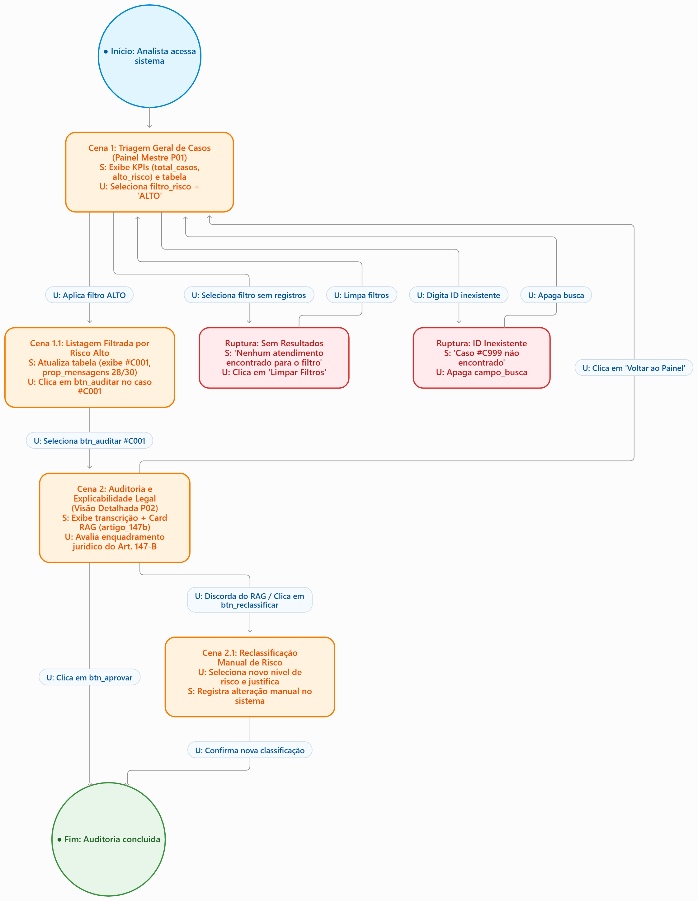

# Entrega 10 — MoLIC

**Data:** 05/11/2026
**Status:** 🟩 concluída 
**Responsabilidade:** 1 solução completa por integrante

## Objetivo da atividade

Modelar a interação como uma **conversa entre usuário e preposto do designer**, oferecendo visão global dos caminhos que permitem ao usuário atingir seus objetivos — incluindo alternativas e rupturas relevantes. MoLIC não deve ser reduzida a um fluxograma de telas.

> Use a **notação MoLIC ensinada na disciplina**. Este template foca critérios de qualidade e não substitui a legenda/notação apresentada em aula.

## Atenção a TCCs sem interface original

O MoLIC não modela o algoritmo por dentro. Ele modela a **conversa de interação necessária para que uma pessoa use a contribuição**.

Exemplos de conversas:

- usuário escolhe dados/parâmetros → sistema valida → usuário inicia análise → sistema comunica processamento → usuário interpreta resultado;
- usuário consulta histórico → refina filtros → abre execução → compara com outra;
- administrador seleciona perfil → altera permissão → sistema comunica consequências → administrador confirma/cancela;
- analista recebe alerta → examina evidências → classifica ocorrência → registra decisão.

Modele também rupturas plausíveis: entrada inválida, falha de processamento, ausência de resultado, permissão insuficiente, filtro sem resultados, conflito de alteração, cancelamento ou necessidade de recuperação.

## M01 — Triagem e Auditoria de Explicabilidade Jurídica do RAG

**Autor(a):** Laura de Souza Parente — 22.123.033-7  
**Cenário de interação de origem:** CI01 — Triagem e Auditoria de Explicabilidade Jurídica do RAG 
**Objetivo(s):** O01, O02, O03, O04, O05, O06, O07, O08 
**Tarefa(s) relacionada(s):** T01 (Auditar histórico e validar fundamentação RAG), T03 (Filtrar casos por nível de risco) 
**Signos relevantes:** `total_casos`, `alto_risco_kpi`, `filtro_risco`, `campo_busca`, `id_caso`, `nivel_risco`, `prop_mensagens`, `artigo_147b`, `btn_auditar`, `btn_aprovar`

### Diagrama

**Fonte editável:** {{adicione aqui o link para o arquivo `.drawio`, `.svg` editável ou outro formato utilizado pela equipe}}

Legenda: Azul = início; Laranja = cenas de interação; Vermelho = rupturas e recuperação; Verde = encerramento.

Figura 1 — Diagrama MoLIC M01: Modelo de Interação para Triagem de Riscos e Auditoria do RAG (Art. 147-B).  
Fonte: Elaborado pela autora (2026).

### Leitura do diagrama

Explique em texto o caminho principal e pelo menos os caminhos alternativos/rupturas mais importantes.

#### Caminho principal

1. Abertura do Sistema: A analista entra na plataforma web e o sistema apresenta a cena **Painel Geral de Triagem**, exibindo os cartões KPI com `total_casos` (132) e `alto_risco_kpi` (28).
2. Filtragem Prioritária: A analista aciona o filtro `filtro_risco` = `ALTO`. O sistema processa e atualiza a listagem mestre apresentando apenas os casos graves.
3. Seleção do Caso: A analista localiza a linha do atendimento `#C001`, verifica a densidade de abuso na `prop_mensagens` (28/30) e clica no `btn_auditar`.
4. Cena de Auditoria e Explicabilidade:** O sistema transita para a visão detalhada, exibindo a transcrição com destaques de abuso e o card de explicabilidade legal contendo o `artigo_147b` do Código Penal.
5. Aprovação do Parecer: A analista avalia a fundamentação, concorda com o enquadramento do RAG e clica no `btn_aprovar`.
6. Encerramento: O sistema regista a validação humana (*human-in-the-loop*), exibe mensagem de sucesso e retorna ao painel mestre atualizado.

#### Alternativas e rupturas

| Situação | Onde ocorre | Como o usuário percebe | Caminho de recuperação/saída |
|---|---|---|---|
| Filtro sem resultados | Na cena de Triagem Geral | O sistema exibe o aviso "Nenhum atendimento encontrado para o nível de risco selecionado". | A analista clica no botão "Limpar Filtros" ou seleciona outro nível de risco (`filtro_risco` = `TODOS`). |
| Busca por ID inexistente | No `campo_busca` | O sistema informa "Código anônimo #C999 não encontrado no banco de dados". | A analista apaga a busca manual para restaurar a listagem mestre completa. |
| Discordância da IA / Dúvida Legal | Na cena de Auditoria RAG | A analista avalia que as mensagens não configuram o Art. 147-B ou possuem gravidade menor (`MÉDIO`). | A analista seleciona `btn_reclassificar`, escolhe o novo nível de risco e preenche a justificativa manual obrigatória antes de confirmar. |
| Cancelamento da Auditoria | Na cena de Auditoria RAG | A analista precisa interromper a análise sem alterar o estado do caso. | A analista clica em "Voltar ao Painel", e o sistema retorna ao estado anterior da triagem sem salvar alterações. |

---

### Checklist específico de modelagem

- [X] Existe **ponto de abertura** coerente com o início do objetivo.
- [X] As **cenas de conversa** representam tópicos/assuntos, não nomes de páginas apenas.
- [X] As transições/falas deixam claro o que o usuário ou o sistema comunica.
- [X] Há **ponto(s) de encerramento** para objetivos concluídos/abandonados quando aplicável.
- [X] Processamentos do sistema estão representados conforme a notação adotada em aula, sem “inventar” fala do usuário.
- [X] Rupturas (breakdowns) relevantes têm feedback e caminho de recuperação, não becos sem saída.
- [X] Acessos ubíquos/atalhos só aparecem quando semanticamente justificáveis.
- [X] O diagrama cobre caminhos alternativos importantes, e não apenas o “happy path”.
- [X] Nomes de objetivos, tópicos e signos são coerentes com a Entrega 9.
- [X] O diagrama é legível em tamanho normal no GitHub.
- [X] O MoLIC representa a conversa usuário–sistema, não o fluxo interno do algoritmo.
- [X] Processamento, filtros, administração, relatórios e históricos incluem retornos/rupturas quando relevantes.

> Repita M02, M03... para todos os integrantes.

## Consolidação da equipe

### Cobertura dos objetivos

| Objetivo | MoLIC que cobre | Lacunas/duplicidades | Decisão |
|---|---|---|---|
| O01 (Garantir Triagem e Auditoria) | M01 | Nenhuma | Coberto na totalidade pela cena principal e auditoria RAG. |
| O02 (Priorizar Casos de Risco Alto) | M01 | Nenhuma | Coberto no filtro dinâmico por risco. |
| O03 (Validar Fundamentação RAG) | M01 | Nenhuma | Coberto na cena detalhada de auditoria do Art. 147-B. |
| O04 (Consultar KPIs) | M01 | Nenhuma | Coberto na cena de abertura do Painel de Triagem. |
| O05 (Filtrar por Risco) | M01 | Nenhuma | Coberto nas opções de filtragem e limpeza. |
| O06 (Identificar ID #C001) | M01 | Nenhuma | Coberto na seleção direta da listagem. |
| O07 (Ler Art. 147-B) | M01 | Nenhuma | Coberto na explicabilidade RAG. |
| O08 (Registrar Parecer/Aprovação) | M01 | Nenhuma | Coberto na decisão humana de Aprovar/Reclassificar. |

---

### Preparação para o Figma

Liste os estados/telas que serão necessários **a partir das conversas modeladas**, incluindo feedback, confirmação, erro e recuperação.

1. Tela P01 — Estado Inicial: Painel mestre com KPIs agregados e tabela completa sem filtros.
2. Tela P01 — Estado Filtrado (Risco Alto): Tabela filtrada contendo apenas casos graves com o ID `#C001` em destaque.
3. Tela P01 — Estado de Ruptura (Lista Vazia): Feedback visual quando o filtro ou busca não encontra registos.
4. Tela P02 — Visão Detalhada de Auditoria (Split-Screen): Painel de transcrição do chat à esquerda + Card RAG com enquadramento do Art. 147-B e botões de ação à direita.
5. Modal de Reclassificação / Confirmação: Caixa de diálogo para registrar observações caso o auditor altere o risco atribuído pela IA.

## Erros frequentes a evitar

- desenhar apenas caixas com nomes de telas e setas de navegação;
- não modelar falhas, cancelamento, volta ou recuperação;
- usar rótulos genéricos (“Tela 1”, “Processo 2”) sem tópico de conversa;
- criar no Figma fluxos que não existem no MoLIC;
- diagrama sem legenda/fonte editável e com texto ilegível.
