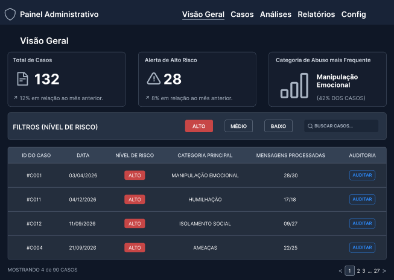
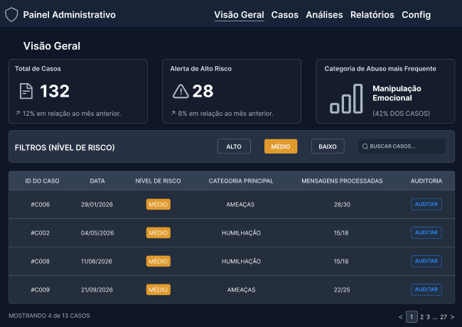
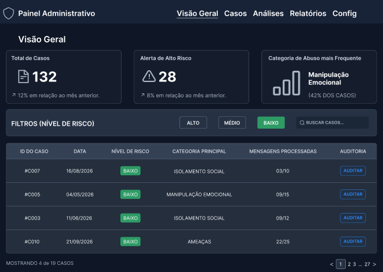
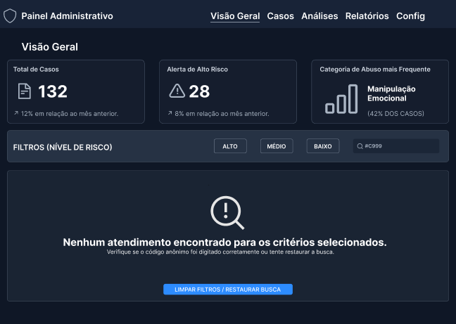
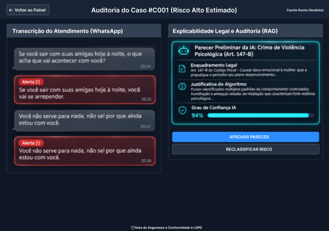
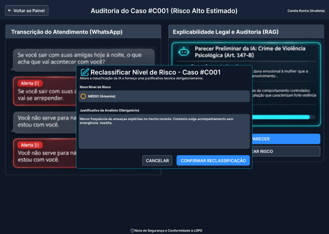
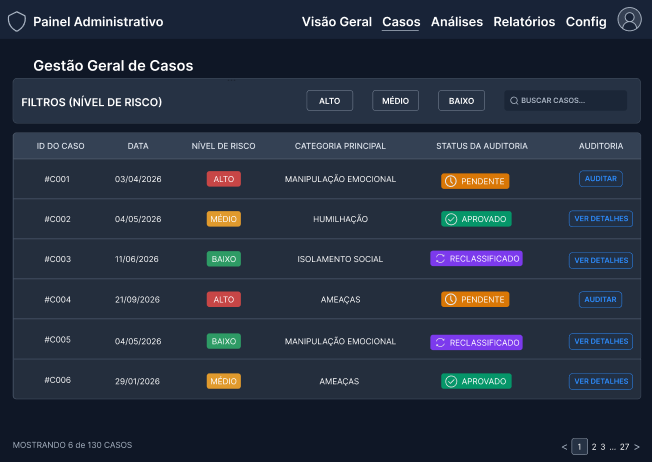
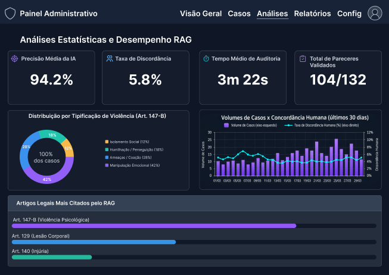
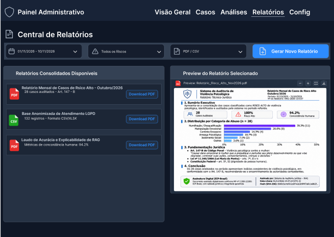

# Entrega 11 — Protótipo no Figma

**Data:** 12/11/2026
**Status:** ✅ concluída 
**Responsabilidade:** 1 protótipo integrado por equipe cobrindo os fluxos MoLIC. Se a turma exigir divisão individual, identifique o responsável por cada fluxo/tela.

## Objetivo da atividade

Materializar o modelo de interação em um protótipo navegável, preservando a lógica dos objetivos, tópicos, signos, feedbacks, alternativas e recuperações definidos anteriormente.

## Biblioteca de possibilidades para projetos técnicos

O protótipo deve materializar os fluxos definidos nas entregas anteriores. Dependendo do escopo, podem fazer sentido:

1. **Dashboard:** indicadores, alertas, estado, tendências e atalhos para tarefas frequentes.
2. **Configuração/parametrização:** escolhas, presets, validação e explicação de opções técnicas.
3. **Entrada de dados:** upload, conexão, seleção, pré-visualização e validação.
4. **Processamento:** fila, status, progresso, cancelamento, falha e reexecução.
5. **Relatório/resultados:** síntese, métricas, gráficos, explicação, exportação e compartilhamento.
6. **Histórico:** busca, filtros, ordenação, paginação, detalhes e repetição de execução.
7. **Comparação:** antes/depois, modelo A/B, execução A/B, baseline ou períodos.
8. **Explicabilidade:** confiança, fatores, evidências, limitações e correção/contestação.
9. **Administração:** usuários, grupos, perfis, permissões, integrações e políticas.
10. **CRUDs de domínio:** somente quando criar/consultar/editar/excluir representa tarefa real.
11. **Auditoria/logs:** histórico de alterações e eventos em linguagem adequada.
12. **Alertas/ocorrências:** severidade, impacto, ação, responsável e resolução.
13. **Ajuda/documentação:** apoio contextual a tarefas complexas.

### Estados que não podem ser esquecidos

Quando aplicável, considere: vazio/sem dados; carregamento/processamento; sucesso; erro de entrada; erro de processamento; filtro sem resultados; permissão insuficiente; confirmação de ação destrutiva; cancelamento/desfazer/recuperação; dados desatualizados/conflito.

> Esta lista é repertório de design, **não uma exigência de quantidade de telas**. A rastreabilidade deve explicar por que cada tela existe.

## Link do Figma

**Protótipo:** https://www.figma.com/design/YVklhni7iJ08TDOFGShxkq/TCC?node-id=0-1&t=BI1G4YValaocs0rX-1
**Arquivo editável:**  https://www.figma.com/proto/YVklhni7iJ08TDOFGShxkq/TCC?node-id=1-446&p=f&t=lF8826yav2mJgo74-1&scaling=contain&content-scaling=fixed&page-id=0%3A1
**Última verificação de permissão:** 12/11/2026

> Teste o link em janela anônima. O avaliador deve conseguir abrir o protótipo sem solicitar permissão.

## Cobertura MoLIC → Figma

| MoLIC | Objetivo | Fluxo/telas no Figma | Estados de erro/recuperação | Responsável |
|---|---|---|---|---|
| M01 | O01 — Triagem e Filtragem de Atendimentos: Monitorar indicadores gerais de risco e filtrar atendimentos por severidade ou código anônimo. | `F01 (Visão Geral) → F02A (Filtro Alto) / F02M (Filtro Médio) / F02B (Filtro Baixo) → F01P (Paginação 2 de 27)` | `F01E (Erro/Busca sem resultados → Limpar Filtros)` | Laura |
| M02 | O02 — Auditoria Individual e Explicabilidade RAG: Confrontar transcrições de WhatsApp com o enquadramento legal sugerido pela IA (Art. 147-B) e aprovar parecer. | `F01 (Visão Geral) / F05 (Casos) → F03 (Auditar Caso #C001) → F04 (Sucesso/Aprovado)` | `Voltar ao Painel (Cancelamento/Retorno seguro)` | Laura |
| M03 | O03 — Reclassificação Humana (Human-in-the-Loop): Discordar do nível de risco estimado pela IA, alterar severidade e registrar justificativa técnica obrigatória. | `F03 (Auditar) → F03R (Modal Reclassificar Risco) → F04 (Sucesso/Atualizado)` | `Botão Cancelar no Modal (Desfazer alteração e retornar a F03)` | Laura |
| M04 | O04 — Gestão Histórica, Métricas RAG e Exportação Jurídica: Consultar histórico completo de casos, auditar acurácia do modelo NLP/RAG e exportar laudos em PDF/CSV. | `F01 → F05 (Casos) / F06 (Análises) / F07 (Relatórios) / F08 (Config)` | `Conformidade LGPD e anonimização de IDs (#C001)` | Laura |

## Catálogo de telas/estados

### F01 — {{nome da tela/estado}}

**Objetivo do usuário:** {{...}}  
**Signos principais:** {{...}}  
**Origem no MoLIC:** {{M01/cena ...}}

### F01 — Visão Geral (Dashboard Principal)

**Objetivo do usuário:** Obter panorama imediato do volume de casos (`132`), alertas de alto risco (`28`) e categoria predominante (`Manipulação Emocional — 42%`), além de iniciar a triagem pela tabela mestre.
**Signos principais:** Cards de KPI, badges semânticos de risco (`ALTO`, `MÉDIO`, `BAIXO`), barra de filtros rápidos, campo de busca por `#ID` e botão de ação `AUDITAR`.
**Origem no MoLIC:** Cena de abertura / Tópico Principal de Monitoramento (`M01`).

### F02A / F02M / F02B — Estados de Filtragem por Risco (Alto, Médio e Baixo)

* **Objetivo do usuário:** Isolar atendimentos conforme o nível de urgência para priorizar casos críticos (`ALTO`), moderados (`MÉDIO`) ou preventivos (`BAIXO`).
* **Signos principais:** Botão de filtro ativo destacado na cor semântica correspondente (vermelho, âmbar ou verde), atualização dinâmica das linhas da tabela e contagem filtrada no rodapé (`Mostrando 4 de 90`, `4 de 13`, `4 de 19 casos`).
* **Origem no MoLIC:** Caminhos alternativos de filtragem e consulta (`M01`).

### F01E — Estado de Ruptura: Busca sem Resultados (Erro/Vazio)

* **Objetivo do usuário:** Identificar que o código pesquisado (ex.: `#C999`) não possui registros e recuperar facilmente a visualização padrão da tabela.
* **Signos principais:** Ícone de lupa com alerta, mensagem clara (*"Nenhum atendimento encontrado para os critérios selecionados"*), instrução de verificação e botão primário de recuperação `LIMPAR FILTROS / RESTAURAR BUSCA`.
* **Origem no MoLIC:** Fala de ruptura / Recuperação de falha de consulta (`M01`).

### F03 — Auditoria Individual e Explicabilidade RAG (Split-Screen)

* **Objetivo do usuário:** Analisar as evidências textuais enviadas pelo agressor no WhatsApp lado a lado com a fundamentação jurídica gerada pelo pipeline RAG (Art. 147-B do Código Penal).
* **Signos principais:** Painel esquerdo com bolhas de mensagens cronológicas e tags vermelhas `Alerta [!]`; painel direito com enquadramento legal, justificativa do algoritmo, barra de `Grau de Confiança IA (94%)`, aviso de conformidade LGPD e botões `APROVAR PARECER` e `RECLASSIFICAR RISCO`.
* **Origem no MoLIC:** Tópico de Inspeção e Validação Jurídica (`M02`).

### F03R — Modal de Reclassificação de Risco (Human-in-the-Loop)

* **Objetivo do usuário:** Sobrescrever a classificação preliminar da IA quando o contexto humano exigir ajuste de severidade, registrando justificativa técnica auditável.
* **Signos principais:** Janela modal sobreposta com fundo escurecido, seletor `Novo Nível de Risco`, campo obrigatório `Justificativa da Analista` e botões `CANCELAR` e `CONFIRMAR RECLASSIFICAÇÃO`.
* **Origem no MoLIC:** Fluxo de Contestação / Intervenção Humana (`M03`).

### F04 — Feedback de Sucesso e Atualização de Status

* **Objetivo do usuário:** Receber confirmação inequívoca de que o parecer do caso `#C001` foi validado e gravado no banco de dados.
* **Signos principais:** Banner flutuante verde no topo (*"Parecer do Atendimento #C001 validado e registrado com sucesso no sistema!"*), alteração do status da linha `#C001` para `AUDITADO / APROVADO` e troca do botão de ação para `VISUALIZAR`.
* **Origem no MoLIC:** Fechamento de diálogo com sucesso (`M02` / `M03`).

### F05 — Gestão Geral de Casos (Histórico Completo)

* **Objetivo do usuário:** Consultar todo o histórico de atendimentos registrados sem a sobrecarga dos KPIs diários, acompanhando o ciclo de vida da auditoria de cada caso.
* **Signos principais:** Coluna dedicada `STATUS DA AUDITORIA` com badges distintos (`PENDENTE`, `APROVADO`, `RECLASSIFICADO`) e ações contextuais (`AUDITAR` para pendentes, `VER DETALHES` para concluídos).
* **Origem no MoLIC:** Tópico de Consulta Histórica (`M04`).

### F06 — Análises Estatísticas e Desempenho do RAG

* **Objetivo do usuário:** Monitorar a confiabilidade técnica do modelo de IA, a taxa de discordância humana e a distribuição das tipificações penais.
* **Signos principais:** 4 cards métricos (`Precisão Média 94.2%`, `Taxa de Discordância 5.8%`, `Tempo Médio 3m 22s`, `Pareceres Validados 104/132`), gráfico de rosca por tipificação do Art. 147-B, gráfico combinado de volume x concordância (30 dias) e ranking de artigos legais mais citados.
* **Origem no MoLIC:** Tópico de Monitoramento Analítico (`M04`).

### F07 — Central de Relatórios e Exportação Jurídica

* **Objetivo do usuário:** Filtrar períodos, gerar laudos consolidados em PDF/CSV e pré-visualizar o documento técnico-jurídico com assinatura digital antes do download.
* **Signos principais:** Filtros de data/risco/formato, botão `Gerar Novo Relatório`, lista de laudos disponíveis para download e painel lateral de `Preview do Relatório Selecionado` contendo sumário executivo, gráficos, fundamentação legal e selo de assinatura digital ICP-Brasil.
* **Origem no MoLIC:** Tópico de Geração de Evidências e Exportação (`M04`).

> Documente também estados que muitas equipes esquecem: carregamento, vazio, confirmação, sucesso, erro, permissão negada, cancelamento, desfazer/voltar quando aplicável.

## Sistema visual e consistência

| Elemento | Regra adotada | Justificativa |
|---|---|---|
| Tipografia | Família sans-serif limpa (`Inter`), hierarquia clara entre títulos (`20–24px Bold`), métricas KPI (`32–36px Bold`), cabeçalhos de tabela (`12px Uppercase`) e corpo de texto (`14px Regular`). | Garante legibilidade rápida em tabelas densas e leitura confortável de transcrições e artigos legais. |
| Cores | Fundo escuro (`#0F172A` / `#1E293B` — Dark Mode) com acentos primários em azul (`#2563EB`) e ciano (`#06B6D4`) para elementos de IA/RAG; cores semânticas reservadas exclusivamente para severidade e status: Vermelho (`#DC2626` — Alto Risco/Alerta), Âmbar (`#D97706` — Médio/Pendente), Verde (`#059669` — Baixo/Aprovado/Sucesso) e Roxo (`#7C3AED` — Reclassificado). | Reduz fadiga visual da analista durante auditorias prolongadas e evita ambiguidade na interpretação imediata do risco jurídico. |
| Componentes | Grid Desktop `1440 × 1024 px` com margens laterais de `40 px`, barra de navegação superior fixa, cards com bordas arredondadas (`8–12 px`) e botões padronizados por hierarquia (sólido para ação principal, outline para secundária). | Mantém previsibilidade espacial e consistência entre todas as abas (`Visão Geral`, `Casos`, `Análises`, `Relatórios`, `Config`). |
| Feedback | Estados ativos visíveis em abas e filtros, badges de status atualizados em tempo real, banner flutuante de sucesso (`F04`), estado vazio com ação de recuperação (`F01E`) e confirmação explícita em modais (`F03R`). | Atende às heurísticas de visibilidade do status do sistema e prevenção/recuperação de erros. |

## Verificação de acessibilidade básica

Para produto Web, considere critérios pertinentes da WCAG vigente (por exemplo, contraste, foco, tamanho de alvo, texto alternativo e navegação por teclado quando aplicáveis). Para outras plataformas, use as recomendações adequadas ao contexto.

* Contraste: Textos principais em branco (`#F8FAFC`) e cinza claro (`#CBD5E1`) sobre fundos escuros (`#0F172A` e `#1E293B`), superando a razão mínima de `4.5:1` recomendada pela WCAG 2.1 AA.
* Redundância semântica (Não depender apenas de cor): Todos os badges de risco e status combinam cor de fundo com rótulos textuais explícitos (`ALTO`, `MÉDIO`, `BAIXO`, `PENDENTE`, `APROVADO`, `RECLASSIFICADO`) e ícones indicadores (`Alerta [!]`, check, relógio), garantindo compreensão para usuários com daltonismo.
* Tamanho de alvos clicáveis: Botões de ação (`AUDITAR`, `APROVAR PARECER`, filtros e paginação) possuem altura mínima entre `36 px` e `44 px` e espaçamento adequado para evitar cliques acidentais.
* Linguagem interpretável: Scores técnicos de confiança da IA (`94%`) são acompanhados de explicação em linguagem jurídica clara e citação direta do Art. 147-B do Código Penal.

## Checklist

- [ ] Link do Figma está acessível.
- [ ] Há screenshots representativos no repositório.
- [ ] Todos os MoLIC relevantes estão cobertos.
- [ ] Estados de erro, feedback e recuperação foram prototipados.
- [ ] Terminologia/signos são consistentes com Entrega 9.
- [ ] Componentes equivalentes se comportam de forma consistente.
- [ ] Fluxos críticos são clicáveis do início ao fim.
- [ ] O protótipo está pronto para inspeção e testes, sem “links mortos” nas tarefas avaliadas.
- [ ] Dashboards, relatórios, históricos, filtros, administração e CRUDs presentes possuem justificativa rastreável.
- [ ] Estados de vazio, processamento, erro e recuperação foram considerados quando pertinentes.
- [ ] Resultados técnicos são apresentados de forma interpretável para o perfil de usuário.
- [ ] A equipe distingue no protótipo o que é interação simulada e o que é funcionalidade técnica realmente integrada, quando necessário.
