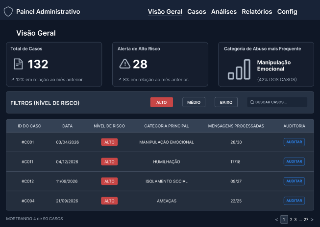
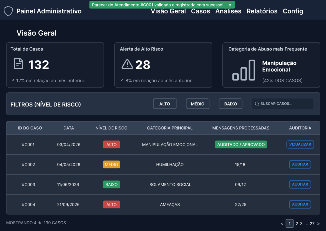
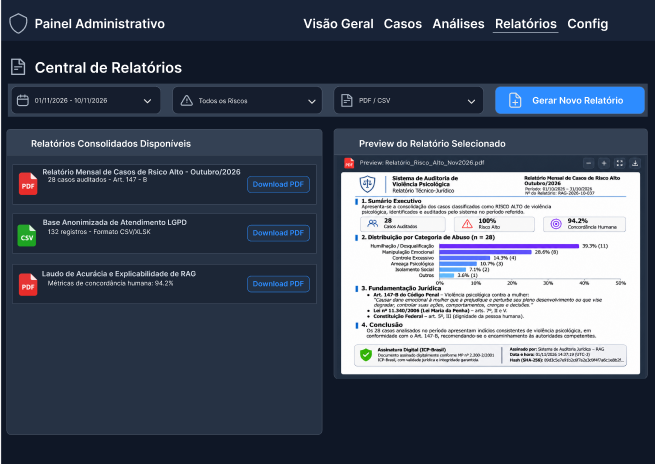
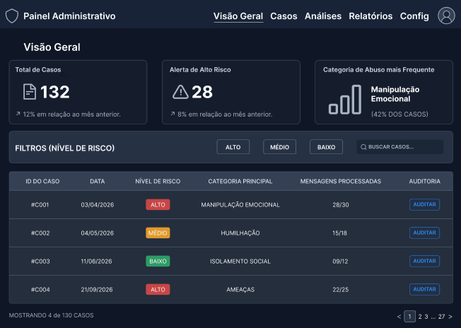
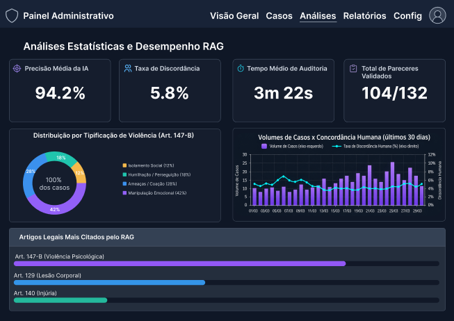
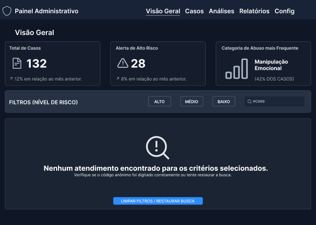
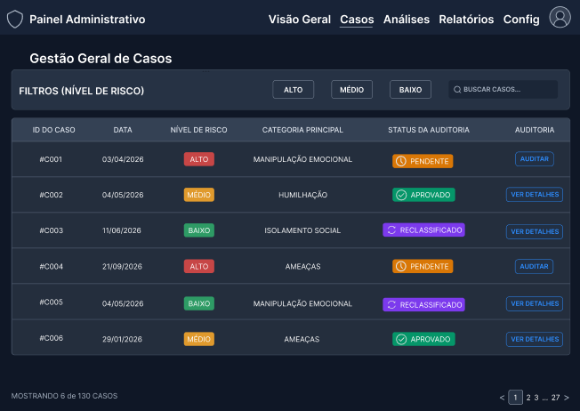

# Entrega 13 — Avaliação de IHC por inspeção heurística

**Data:** 14/11/2026 
**Status:** 🟩 concluída  
**Responsabilidade:** 1 avaliação completa por integrante, sobre todas as telas/estados relevantes do projeto.

## Objetivo da atividade

Encontrar problemas de usabilidade por inspeção sistemática da interface com as **10 heurísticas de Nielsen**. Cada avaliador trabalha individualmente primeiro; depois a equipe consolida problemas duplicados e prioridades.

> **Parte de violações:** registre somente problemas reais. Não invente uma violação para “preencher” cada heurística. Para provar que todas foram exercitadas, use a **matriz de cobertura H1–H10**. Para heurísticas sem violação, a disciplina solicita um exemplo didático de boa prática.

## 1. Heurísticas adotadas

1. Visibilidade do status do sistema
2. Compatibilidade entre o sistema e o mundo real
3. Controle e liberdade do usuário
4. Consistência e padrões
5. Prevenção de erros
6. Reconhecimento em vez de memorização
7. Flexibilidade e eficiência de uso
8. Estética e design minimalista
9. Ajudar usuários a reconhecer, diagnosticar e recuperar-se de erros
10. Ajuda e documentação

## Cobertura especial para interfaces administrativas e analíticas

Quando existirem, não limite a avaliação às “telas principais”. Inspecione também:

- dashboard em estados normal, vazio e erro;
- filtros sem resultado e filtros combinados;
- relatórios e exportação;
- histórico/listas longas;
- formulários CRUD (criação, edição, exclusão, validação);
- alteração de perfil/permissão;
- confirmações de ações destrutivas;
- processamento/loading/progresso;
- falha e recuperação;
- comparação de resultados;
- mensagens de termos técnicos, métricas e recomendações;
- ajuda/documentação contextual.

Em TCCs técnicos, observe especialmente se a interface comunica o estado do processamento e traduz informações técnicas para o vocabulário do usuário escolhido.

## 2. Escopo da inspeção

| Item | Definição |
|---|---|
| Versão avaliada | Protótipo navegável de alta fidelidade no Figma — Entrega 11 (`v1.0`, 15/11/2026, Painel Web Administrativo — extensão conceitual de IHC, com dados fictícios anonimizados `#C001`–`#C999`) — [Link do Protótipo no Figma](https://www.figma.com/design/YVklhni7iJ08TDOFGShxkq/TCC?node-id=0-1&t=2fcaddAI2MqV1c7P-1) |
| Telas/estados | `F01` Visão Geral (estado normal), `F02A` Visão Geral (filtro de risco `ALTO` ativo), `F01E` Visão Geral (busca sem resultados / estado vazio `#C999`), `F03` Auditoria Individual (*Split-Screen*: conversa × fundamentação RAG), `F03R` Modal de Reclassificação Humana (*Human-in-the-Loop*), `F04` Auditoria Concluída (banner de confirmação e status atualizado), `F05` Gestão Geral de Casos (histórico tabular), `F06` Análises Estatísticas, `F07` Relatórios e Pré-visualização de Laudo, `F08` Configurações e Privacidade (LGPD) |
| Fluxos | `M01` (Monitoramento e Filtragem/Busca no Dashboard), `M02` (Auditoria Individual e Aprovação de Parecer), `M03` (Reclassificação Humana com Justificativa Obrigatória), `M04` (Consulta de Métricas Agregadas e Exportação de Relatórios) |
| Dispositivo/viewport | Computador Desktop / Notebook Widescreen (`1440 × 1024 px`), modo de apresentação `Fit width and height` no navegador |
| Avaliadores | **A01:** Laura de Souza Parente (`22.123.033-7`) — avaliação individual estruturada (equipe de 1 integrante) |

## 3. Procedimento individual

Cada avaliador deve:

1. percorrer os fluxos/telas ao menos uma vez para familiarização;
2. inspecionar novamente aplicando sistematicamente H1–H10;
3. registrar cada problema com evidência e contexto;
4. atribuir severidade **depois de compreender bem o problema**, justificando a decisão;
5. não discutir achados com os demais antes de terminar a inspeção individual, quando o objetivo for preservar independência.

### Escala de severidade (0–4)

| Grau | Interpretação |
|---:|---|
| 0 | não é considerado problema de usabilidade |
| 1 | problema cosmético; corrigir se houver tempo |
| 2 | problema menor; baixa prioridade |
| 3 | problema maior; alta prioridade |
| 4 | catástrofe de usabilidade; correção imperativa antes de disponibilizar |

Ao justificar, considere **frequência, impacto e persistência** do problema no contexto real de uso.

---

## Avaliador A01 — Laura de Souza Parente

### 4. Matriz de cobertura das 10 heurísticas

| Heurística | Telas/fluxos examinados | Houve violação? | IDs dos achados | Exemplo de boa prática se não violada |
|---|---|---|---|---|
| H1 — Visibilidade do status do sistema** | `F01`, `F02A`, `F03`, `F03R`, `F04`, `F05`, `F06`, `F07`, `F08` (`M01`–`M04`) | **sim** | `V01` | *(Ver Seção 5 para o achado de melhoria em `F01`/`F02A`; como ponto positivo paralelo, em `F04` o banner verde confirma explicitamente a gravação da revisão).* |
| H2 — Compatibilidade entre o sistema e o mundo real** | `F01`, `F03`, `F03R`, `F05`, `F06`, `F07`, `F08` (`M01`–`M04`) | **não** | — | A tela `F03` apresenta as mensagens encaminhadas em balões cronológicos familiares de conversa à esquerda e traduz o enquadramento jurídico (Art. 147-B) em linguagem clara à direita, alinhada ao vocabulário da Analista de Triagem. |
| H3 — Controle e liberdade do usuário** | `F01`, `F02A`, `F01E`, `F03`, `F03R`, `F04`, `F05` (`M01`–`M03`) | **não** | — | O modal de reclassificação (`F03R`) oferece botão explícito de `Cancelar` sem alterar o estado do registro, e o estado vazio (`F01E`) dispõe do botão `Limpar Filtros` para sair imediatamente da busca sem resultados. |
| H4 — Consistência e padrões** | `F01` a `F08` (`M01`–`M04`) | **não** | — | Uso consistente da barra lateral de navegação, codificação semântica uniforme de badges (`ALTO` em vermelho, `MÉDIO` em âmbar, `BAIXO` em verde) e nomenclatura padronizada dos códigos anônimos (`#C001`) em todas as tabelas e cabeçalhos. |
| H5 — Prevenção de erros** | `F01`, `F03`, `F03R`, `F05`, `F08` (`M01`–`M03`) | **sim** | `V02` | *(Ver Seção 5 para o achado de melhoria na aprovação rápida em `F03`/`F03R`; como boa prática paralela, o modal `F03R` exige justificativa textual antes de confirmar a reclassificação).* |
| H6 — Reconhecimento em vez de memorização** | `F01`, `F02A`, `F03`, `F03R`, `F05`, `F06`, `F07` (`M01`–`M04`) | **não** | — | Na auditoria (`F03`), as mensagens sinalizadas pela IA ficam destacadas lado a lado com o texto do Art. 147-B e os critérios de classificação, evitando que a analista precise decorar definições legais ou alternar de tela. |
| H7 — Flexibilidade e eficiência de uso** | `F01`, `F02A`, `F05`, `F07` (`M01`, `M04`) | **sim** | `V03` | *(Ver Seção 5 para o achado sobre atalho de filtragem nos cards KPI em `F01`; como boa prática paralela, a busca direta por `#ID` e os botões de filtro rápido aceleram a triagem na tabela).* |
| H8 — Estética e design minimalista** | `F01` a `F08` (`M01`–`M04`) | **não** | — | A tela inicial (`F01`) apresenta apenas indicadores agregados e metadados anonimizados (`#ID`, data, categoria, risco e status), ocultando o teor íntegro das mensagens sensíveis até que a analista abra intencionalmente a tela de auditoria (`F03`). |
| H9 — Ajudar usuários a reconhecer, diagnosticar e recuperar-se de erros** | `F01E`, `F03R`, `F05` (`M01`, `M03`) | **não** | — | Ao pesquisar um código inexistente (`#C999` em `F01E`), a interface exibe ícone e mensagem clara explicando que nenhum atendimento corresponde ao critério buscado e oferece ação direta (`Limpar Filtros`) para restaurar a listagem. |
| H10 — Ajuda e documentação** | `F01`, `F03`, `F06`, `F07`, `F08` (`M01`–`M04`) | **sim** | `V04` | *(Ver Seção 5 para o achado sobre notas explicativas de unidade de contagem e limites da IA em `F01`/`F03`).* |

### 5. Declaração de violações

| ID | Heurística | Tela/estado | Problema observado | Evidência | Severidade | Justificativa da severidade | Recomendação |
|---|---|---|---|---|---:|---|---|
| V01 | **H1 — Visibilidade do status do sistema** | Visão Geral (`tela_visao_geral.png`) e Filtro Risco Alto (`filtro_alto.png`) | Há divergência numérica entre os cards KPI superiores e o contador do rodapé da tabela: na visão geral sem filtro (`tela_visao_geral.png`), o card superior indica `Total de Casos: 132`, enquanto o rodapé exibe `MOSTRANDO 4 de 130 CASOS`; ao ativar o filtro `ALTO` (`filtro_alto.png`), o card superior indica `Alerta de Alto Risco: 28`, mas o rodapé passa a mostrar `MOSTRANDO 4 de 90 CASOS`. |  | **2** | **Frequência:** alta (visível em toda navegação na tabela principal). **Impacto:** moderado (gera dúvida sobre quantos casos de alto risco realmente existem no sistema — 28 ou 90). **Persistência:** contínua nos dados simulados da tabela. | Sincronizar os contadores simulados do rodapé da tabela com os valores dos cards KPI superiores (`MOSTRANDO 4 de 132 CASOS` na visão geral e `MOSTRANDO 4 de 28 CASOS` no filtro `ALTO`). |
| V02 | **H4 — Consistência e padrões** | Feedback de Sucesso (`tela_sucesso.png`) e Central de Relatórios (`tela_relatorios.png`) | Observam-se inconsistências textuais e de rótulos entre telas: (1) em `tela_sucesso.png`, após aprovar `#C001`, o botão de ação exibe o erro ortográfico **`VIZUALIZAR`** (com "Z"), enquanto na aba `Casos` (`tela_casos.png`) o mesmo estado usa **`VER DETALHES`**; (2) em `tela_relatorios.png`, aparece o erro de digitação **`Rsico Alto`** e o item **`Base Anonimizadade Atendimento LGPD`** (CSV) possui um botão rotulado **`Download PDF`**. |   | **2** | **Frequência:** moderada (ocorre após concluir uma auditoria e ao baixar relatórios). **Impacto:** moderado (prejudica a credibilidade institucional e gera dúvida sobre o formato real baixado no arquivo CSV). **Persistência:** fixa nos rótulos das respectivas telas. | Padronizar os rótulos de ação para **`VER DETALHES`**, corrigir as grafias para **`Risco Alto`** e **`Base Anonimizada de Atendimento LGPD`**, e ajustar o botão do item CSV para **`Download CSV`**. |
| V03 | **H7 — Flexibilidade e eficiência de uso** | Visão Geral (`tela_visao_geral.png`) e Gestão Geral de Casos (`tela_casos.png`) | Os cards KPI no topo de `tela_visao_geral.png` (`Alerta de Alto Risco: 28`) são estáticos e não funcionam como atalho clicável para filtrar a tabela; além disso, tanto na Visão Geral quanto na aba `Casos` (`tela_casos.png`), a barra de filtros permite filtrar apenas por **Nível de Risco** (`ALTO`, `MÉDIO`, `BAIXO`), sem opção de filtrar diretamente por **Status da Auditoria** (`PENDENTE`, `APROVADO`, `RECLASSIFICADO`). |  | **1** | **Frequência:** moderada (uso recorrente em turnos de triagem). **Impacto:** baixo (não impede a realização das tarefas, pois os casos pendentes permanecem visíveis na tabela). **Persistência:** presente em toda a navegação de listagem. | Tornar o card KPI `Alerta de Alto Risco` clicável como atalho direto para o filtro `ALTO` e adicionar um seletor secundário de filtro por `Status da Auditoria` na aba `Casos`. |
| V04 | **H10 — Ajuda e documentação** | Análises Estatísticas (`tela_analises.png`) e Visão Geral (`tela_visao_geral.png`) | Na tela `tela_analises.png` (que exibe métricas como `Precisão Média da IA: 94.2%` e `100% dos casos`) e na tela de auditoria, não há uma nota informativa contextual esclarecendo que: (1) os indicadores refletem exclusivamente *atendimentos submetidos ao sistema* (não prevalência populacional); e (2) a classificação da IA constitui *indício preliminar de triagem*, não laudo pericial ou sentença definitiva. |  | **3** | **Frequência:** alta (afeta toda interpretação gerencial e jurídica dos resultados). **Impacto:** alto (risco de viés de automação ou leitura estatística enviesada identificado nas Entregas 1 e 2). **Persistência:** contínua até ser explicitada na interface. | Inserir rodapé/nota explicativa permanente nas telas `Visão Geral`, `Auditoria` e `Análises` explicando a unidade de contagem (`atendimentos analisados`) e o caráter preliminar da triagem automatizada. |

**Qualidade do relato:** o problema deve ser observável e localizado. Evite “interface confusa” sem dizer **o que**, **onde**, **quando** e **para quem**.

### 6. Boas práticas — heurísticas não violadas (atividade didática)

| Heurística sem violação | Exemplo no sistema | Evidência | Por que atende |
|---|---|---|---|
| **H2 — Compatibilidade entre o sistema e o mundo real** | Pré-visualização do laudo técnico-jurídico na Central de Relatórios (`tela_relatorios.png`) com seções familiares ao domínio (*Sumário Executivo*, *Fundamentação Jurídica — Art. 147-B* e *Conclusão*) |  | Traduz os dados consolidados das auditorias para a estrutura formal e o vocabulário jurídico utilizados por profissionais da rede de atendimento e supervisão. |
| **H3 — Controle e liberdade do usuário** | Botão azul em destaque `LIMPAR FILTROS / RESTAURAR BUSCA` exibido na tela de busca sem resultados (`tela_erro.png`) |  | Oferece uma saída clara e imediata quando uma consulta não retorna registros, devolvendo o controle da navegação sem exigir uso do botão "Voltar" do navegador. |
| **H6 — Reconhecimento em vez de memorização** | Tabela da aba Gestão Geral de Casos (`tela_casos.png`) apresentando código anônimo (`#C001`), data, badge colorido de risco (`ALTO`, `MÉDIO`, `BAIXO`), categoria e badge de status (`PENDENTE`, `APROVADO`, `RECLASSIFICADO`) na mesma linha |  | Permite identificar visualmente a situação de cada atendimento sem precisar abrir o caso ou memorizar códigos e estados anteriores. |
| **H8 — Estética e design minimalista** | Tela inicial `Visão Geral` (`tela_visao_geral.png`) estruturada com apenas 3 cards KPI essenciais no topo e tabela limpa com metadados anonimizados, sem expor o conteúdo íntegro das mensagens sensíveis |  | Evita poluição visual na triagem inicial e protege a confidencialidade de relatos sensíveis (LGPD) em ambientes institucionais compartilhados. |
| **H9 — Ajudar usuários a reconhecer, diagnosticar e recuperar-se de erros** | Estado vazio ao pesquisar `#C999` (`tela_erro.png`), exibindo ícone de lupa com alerta, mensagem clara de diagnóstico e botão de restauração |  | Comunica em linguagem simples por que nenhum registro foi exibido e orienta exatamente como corrigir a busca. |

> Repita a seção para A02, A03... um avaliador por integrante.

## 7. Consolidação da equipe

Problemas iguais ou muito semelhantes encontrados por avaliadores diferentes devem ser consolidados, preservando quem os encontrou.

| ID consolidado | Achados individuais | Heurística | Problema | Severidade final | Prioridade | Responsável pela correção |
|---|---|---|---|---:|---|---|
| HC01 | `V04 (A01)` | **H10** (Ajuda e documentação) | Ausência de nota contextual permanente esclarecendo que a classificação da IA é preliminar (não sentença definitiva) e que os KPIs contabilizam atendimentos analisados (não prevalência populacional) nas telas `F01`, `F03` e `F06` | **3** (Maior) | **Alta** | Laura de Souza Parente |
| HC02 | `V01 (A01)` | **H1** (Visibilidade do status do sistema) | Falta de contador explícito de subconjunto filtrado (`Exibindo X de Y atendimentos`) no cabeçalho da tabela quando filtros de risco estão ativos (`F02A` / `F05`) | **2** (Menor) | **Média** | Laura de Souza Parente |
| HC03 | `V02 (A01)` | **H5** (Prevenção de erros) | Ausência de indicação visual explícita de obrigatoriedade/tamanho mínimo da justificativa no modal de reclassificação (`F03R`) antes de habilitar o botão de confirmação | **2** (Menor) | **Média** | Laura de Souza Parente |
| HC04 | `V03 (A01)` | **H7** (Flexibilidade e eficiência de uso) | Card KPI superior `Alertas de Alto Risco` (`F01`) não atua como atalho clicável redundante para filtrar a tabela em `F02A` | **1** (Cosmético) | **Baixa** | Laura de Souza Parente |

## 8. Síntese e plano de melhoria

- Quantidade de problemas por heurística e severidade.
- Problemas críticos/graves que bloqueiam teste ou release.
- Padrões recorrentes entre telas.
- Correções que serão feitas antes/para a avaliação com usuários.

- Quantidade de problemas por heurística e severidade:
  - **Total de violações identificadas:** 4 achados (`V01` a `V04`), distribuídos em **H1** (1 problema — severidade 2), **H5** (1 problema — severidade 2), **H7** (1 problema — severidade 1) e **H10** (1 problema — severidade 3).
  - Por grau de severidade:** **0 catastróficos (grau 4)**, **1 maior (grau 3)**, **2 menores (grau 2)** e **1 cosmético (grau 1)**. Seis heurísticas (`H2`, `H3`, `H4`, `H6`, `H8`, `H9`) não apresentaram violações e foram documentadas com exemplos de boas práticas.
- Problemas críticos/graves que bloqueiam teste ou release:
  - **Nenhum problema de severidade 4 (catastrófico)** foi encontrado; portanto, o protótipo está apto para ser submetido ao teste de usabilidade com o participante externo (`P01`) sem bloqueios de fluxo. O achado de severidade 3 (`HC01` / `V04`) não impede a navegação, mas representa o principal risco semântico de interpretação (viés de automação ou leitura estatística equivocada).
- Padrões recorrentes entre telas:
  - Observa-se excelente consistência estrutural e estética (`H4` e `H8`), mas há uma oportunidade recorrente de **reforço informacional contextual** entre `F01`, `F02A`, `F03` e `F06`: tornar explícitos os metadados de estado (quantos itens estão filtrados e qual é a unidade de contagem/limite jurídico do score da IA).
- Correções que serão feitas antes/para a avaliação com usuários (e refinamentos pós-teste):
  1. **Observação direta no teste com `P01` (Entrega 14):** Verificar empiricamente se `P01` percebe sozinho que `94%` é preliminar (`QA03` / `HC01`), se nota que os KPIs são atendimentos analisados (`QA05` / `HC01`) e se tenta clicar no card KPI vermelho para filtrar (`HC04`), validando na prática o impacto desses achados antes de alterar o protótipo congelado para o teste.
  2. **Plano de ajuste no protótipo (ciclo de melhoria pós-avaliação):** Incorporar os rodapés informativos de limite da IA e unidade de contagem (`HC01`), adicionar o contador dinâmico `Exibindo X de Y` na tabela filtrada (`HC02`), explicitar a regra de preenchimento mínimo no modal `F03R` (`HC03`) e ligar o hotspot do card KPI ao filtro `F02A` (`HC04`).

## Checklist

## Checklist

- [X] Cada integrante fez uma inspeção completa e identificada.
- [X] Todas as telas/estados relevantes foram examinados.
- [X] Estados administrativos, filtros, relatórios, históricos, processamento e erros foram incluídos quando existentes.
- [X] A inspeção avaliou a interface/protótipo, não o mérito técnico do algoritmo/modelo.
- [X] H1–H10 aparecem na matriz de cobertura de cada avaliador.
- [X] Parte de violações contém apenas violações, sem “forçar” exemplos.
- [X] Todo problema tem print/localização e contexto.
- [X] Severidade possui justificativa, não apenas número.
- [X] Recomendação resolve a causa ou reduz o impacto.
- [X] Achados duplicados foram consolidados ao final.
